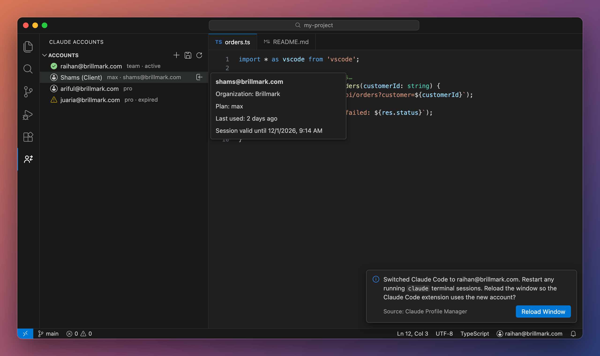
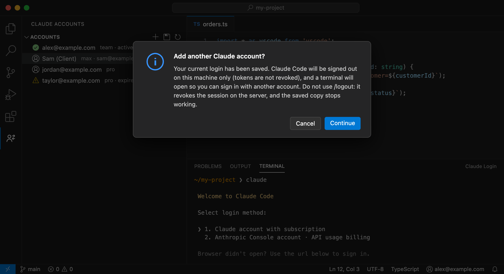
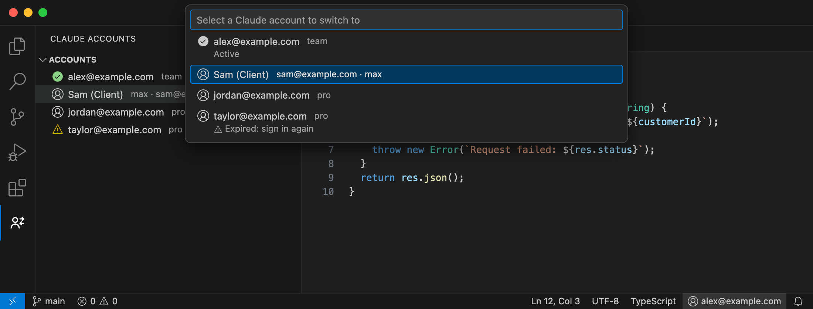

# Claude Account Manager

Save several Claude Code accounts on your machine and switch between them in one click, without signing in again.



> Unofficial community project. Not affiliated with or endorsed by Anthropic.

## Features

- **Multiple saved sessions.** Each Claude account you sign in with is saved locally, and you can store as many as you like.
- **One-click switching** from the sidebar, the status bar, or `Claude Accounts: Switch Account…` in the Command Palette.
- **No extra sign-ins.** Switching restores the session from when you last signed in to that account.
- **Token refresh sync.** When Claude Code refreshes the active account's tokens, the saved copy is updated too, so it stays valid.
- **Local only.** Tokens stay in your OS keychain through VS Code Secret Storage. The extension makes no network requests.
- Works with the **Claude Code VS Code extension** and the **`claude` CLI**, because both read the same login.

## Getting started

1. Sign in to Claude Code as usual (in the Claude Code extension, or by running `claude` in a terminal).
2. Open the **Claude Accounts** view in the Activity Bar and click **Save Current Login**.
3. Click **Add Account** (`+`). The extension:
   - saves your current session,
   - signs Claude Code out **on this machine only**,
   - opens a terminal running `claude` so you can sign in with the next account,
   - saves that account as soon as sign-in finishes.
   

4. Repeat for every account. To switch, click **→** next to an account, or click the account name in the status bar to open the account picker:

   

5. Reload the window when prompted so the Claude Code extension picks up the new account. Restart any `claude` sessions already running in a terminal.

### What the icons mean

| Icon | Meaning |
| --- | --- |
| ✅ green check | The account Claude Code is using right now |
| 👤 person | A saved account you can switch to |
| ⚠️ warning | The saved session has expired; sign in to it again and click **Save Current Login** |
| ○ empty circle | Claude Code is signed in with an account that isn't saved yet |

Hover over an account to see its organization, plan, when you last used it, and how long its session stays valid.

> ⚠️ **Don't use `/logout` on an account you have saved.** It revokes the session on Anthropic's servers, and the saved copy stops working. Use **Add Account** instead.

## How it works

Claude Code stores its active login in two places:

| What | macOS | Linux / Windows |
| --- | --- | --- |
| OAuth tokens | Keychain item `Claude Code-credentials` | `~/.claude/.credentials.json` |
| Account identity | `oauthAccount` in `~/.claude.json` | `oauthAccount` in `~/.claude.json` |

Saving copies both into VS Code Secret Storage. Switching first saves the outgoing account's newest tokens, then writes the target account's tokens and `oauthAccount` back. Only the `oauthAccount` key in `~/.claude.json` is changed. Everything else in that file is left as it was.

If `CLAUDE_CONFIG_DIR` is set, files are read from that directory instead.

### When you'll need to sign in again

A saved session lasts as long as its refresh token does. You'll need to sign in to an account again if:

- its refresh token expires (the account shows ⚠ **expired**),
- you signed out of it, or it was revoked elsewhere (for example, by changing your password or using `/logout`),
- the same account was used on another machine and its token was rotated there.

In each case, sign in again and click **Save Current Login**. The saved entry is updated in place.

## Removing saved sessions

Right-click an account and choose **Remove Saved Session**, or run **Claude Accounts: Remove All Saved Sessions…** from the Command Palette or the view's `…` menu. Do this before uninstalling: VS Code doesn't let extensions delete their saved data on uninstall. Claude Code stays signed in to its current account either way.

## Settings

| Setting | Default | Description |
| --- | --- | --- |
| `claudeSessions.reloadAfterSwitch` | `ask` | `ask`, `always` or `never` reload the window after switching |
| `claudeSessions.autoSyncIntervalMinutes` | `5` | How often to sync the active account's refreshed tokens (`0` turns it off) |
| `claudeSessions.configDir` | `""` | Override the Claude config directory |
| `claudeSessions.keychainService` | `Claude Code-credentials` | macOS Keychain service name |
| `claudeSessions.loginCommand` | `claude` | Command run in the terminal when adding an account |

For security, `configDir`, `keychainService` and `loginCommand` can only be set in your user settings, never in a workspace's `.vscode/settings.json`. The extension only runs in trusted workspaces.

## Development

```bash
npm install
npm run compile
npm test
```

Press <kbd>F5</kbd> to launch an Extension Development Host. See [CONTRIBUTING.md](CONTRIBUTING.md).

The images in `docs/images/` are rendered from [docs/screenshots-source.html](docs/screenshots-source.html) using sample accounts. To regenerate one, open the file with `#overview`, `#quickpick` or `#addaccount` at the end of the URL and take a screenshot at 2× scale.

Build a `.vsix`:

```bash
npm run vsce:package
```

## Security

See [SECURITY.md](SECURITY.md). In short, tokens are kept in OS-encrypted storage, never logged, and never leave your machine.

## License

[MIT](LICENSE)
